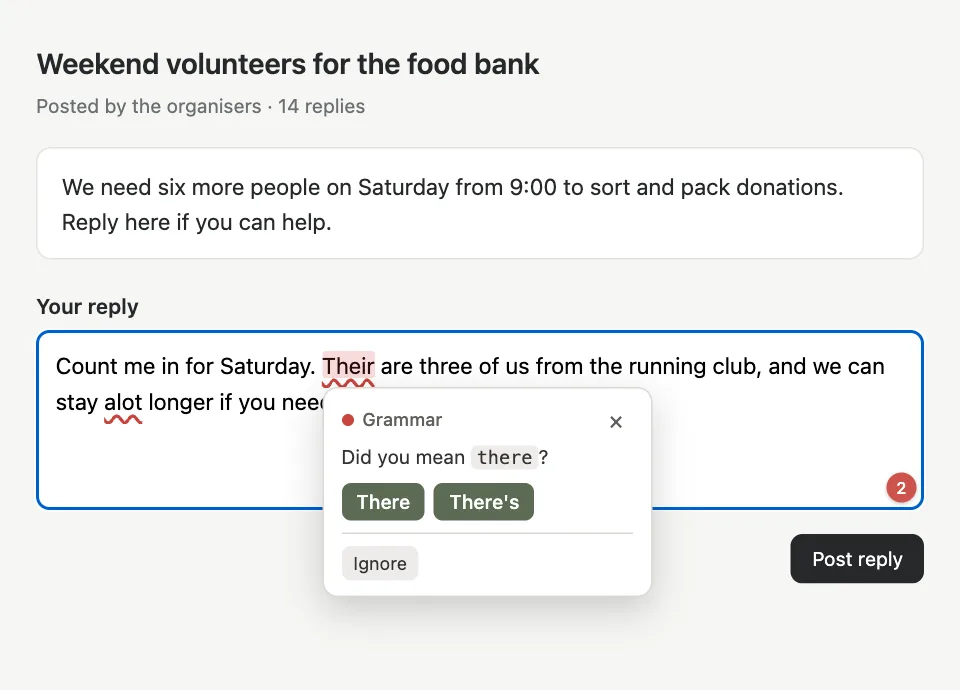

## Overview

GrammarMe underlines spelling, grammar and punctuation mistakes as you type, explains each one, and fixes it in one click. There are two ways to use it: a web editor and a Chrome extension for text boxes on websites, including rich-text editors such as Gmail. The grammar engine is [Harper](https://writewithharper.com), an open-source checker compiled to WebAssembly, so your text is checked inside your browser. I built everything around it: the editor, the extension, the suggestion logic, the evaluation, and two optional AI routes.

## The problem

Most writing assistants send what you type to a server, and the good ones need a subscription. I wanted one with three hard limits: text stays on the device by default, it costs $0 to run, and it stays light enough for an 8 GB laptop. A local rule engine cannot catch everything, so AI is available for the gaps, but it stays off until you ask for it.

## System architecture

```text
you type in a <textarea>
  → underlines shift instantly (no network)
  → 300 ms debounce → Harper (WASM) in a Web Worker
  → suggestions for document version N, rebased onto the current text
  → underlines, card and sidebar → accept as a normal undoable edit

only when you press the AI button:
  web editor → your own Cloudflare Worker → LLM provider
  extension  → local companion program → your ChatGPT plan
```

1. **Shared core.** One TypeScript package holds the suggestion contract, the edit helpers, the Harper adapter, and the AI prompts and guards. The editor and the extension both build on it.
2. **Web editor.** React and Vite, with Harper in a Web Worker so loading the 20 MB WASM file never stalls typing.
3. **Chrome extension.** One Harper instance runs in an offscreen document and all tabs share it, instead of loading a copy per tab.
4. **Optional AI.** Off by default and sent only on request. The web editor calls a Cloudflare Worker that you deploy on your own free account. The extension can use your own ChatGPT Plus or Pro plan through a small local companion, with no API key.

## Implementation decisions

- **Harper over LanguageTool.** LanguageTool catches more, but it means either sending text to a third-party API or running a Java server that needs 1 to 2 GB of RAM. Harper needs neither. I accepted the lower recall and left the gap to the optional AI check.
- **Fixes can't land in the wrong place.** Results arrive while you keep typing, so every edit bumps a document version. Underlines are rebased on each keystroke, late results are rebased too, and a fix is refused unless its version is current and the text at that position still matches.
- **A plain textarea, not a rich-text framework.** A native `<textarea>` sits on top of a backdrop that only draws the underlines. That gives native undo, caret behaviour and IME support for free, and avoids mapping between editor positions and string offsets.
- **AI edits are located by quoting text.** Models count characters badly, so the model quotes what it wants to change and code finds that text. Missing, ambiguous or no-op edits are rejected.
- **ChatGPT credentials stay on your computer.** OpenAI's sign-in for local apps finishes on a `127.0.0.1` address, which an extension can't receive. A companion started by Chrome handles the sign-in and keeps the credentials in files on disk instead of in the browser or on a server.



## Evaluation

I wrote a labeled dataset of **171 sentences**: 125 with **128 known errors**, and 46 correct sentences to measure false alarms. These are the on-device results with the settings GrammarMe ships, in American English, with no AI:

| Category | Errors | Caught |
|---|---:|---:|
| Spelling | 30 | 30 |
| Articles | 15 | 15 |
| Word choice | 22 | 16 |
| Punctuation | 16 | 10 |
| Tense | 14 | 8 |
| Subject-verb agreement | 19 | 10 |
| Wordiness | 12 | 0 |
| **Total** | **128** | **89** |

- **Precision:** 84.0% (89 of 106 flags). All 17 false alarms were on the correct sentences.
- **Recall:** 69.5% (89 of 128 errors).
- **Correct fix:** 93.3% of caught errors (83 of 89) had the right top suggestion.
- **False alarms:** 10 of the 46 correct sentences (21.7%) were flagged at least once.
- **Speed:** about 1.2 ms per sentence and about 49 ms for a 1,196-word document, measured in Node on an Apple M1 Pro, not in a browser.

What I take from this:

- **Evaluating changed the defaults.** Before tuning, precision was 78.8% and 30.4% of correct sentences were flagged. The results showed one rule suggesting "a dress" for *adress*, and another hiding every other error inside long sentences. Turning off three rules and skipping spell-check on code-like words and acronyms brought those to 84.0% and 21.7%.
- **The misses have a pattern.** Harper catches *He go* but no agreement errors with a longer subject, such as *The list of items are*. It also misses tense that depends on context, such as *Yesterday I go*, and all 12 wordiness examples. That is the case for keeping AI as an add-on.
- **False alarms are mostly proper nouns and dialect.** British spellings were all flagged under the American setting, and names such as *São Paulo* often were. Choosing the British dialect cleared the British spellings in an earlier run.

## Limitations

- **The dataset is small and I wrote it.** The numbers show how settings compare, not how the checker does on real writing, and I know which errors are in it.
- **Lower recall than a commercial tool.** Without AI, about 3 in 10 errors in the dataset go unflagged. I have not run a side-by-side comparison with Grammarly, and AI suggestion quality is not measured yet.
- **The extension is a prototype.** It installs by hand in Developer mode, updates by hand, works on desktop only, and doesn't support Google Docs.
- **The ChatGPT route has narrow eligibility.** It needs the companion on macOS or Linux and a Plus or Pro plan. OpenAI allows plan usage for local open-source tools, but its pages don't mention browser extensions, so this route could change.
- **Optional AI leaves your device.** When you use it, text goes to your own Worker and the model provider you chose, or to OpenAI with your ChatGPT plan. It is off by default, and in the extension you preview the text before it is sent.

## What I learned

- Measure before picking defaults. A rule that looks useful can hide other errors, and only a labeled set showed it.
- Decide where each kind of check should run. Fast rules suit the device and harder rewrites suit an LLM, but only with the privacy trade-off made explicit.
- Treat user text as the thing that must never break. Most of the engineering in the editor goes into making sure a suggestion can't land in the wrong place while someone is typing.

**Next:** a side-by-side comparison of AI providers on this same dataset, a larger set of real writing that I didn't write myself, and a Chrome Web Store release so the extension no longer needs Developer mode.
