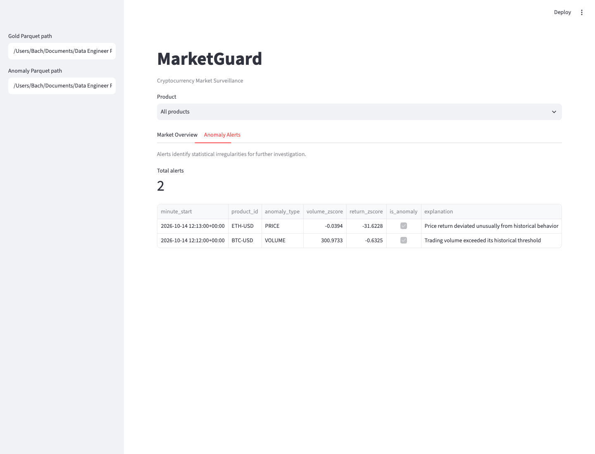

## Overview

MarketGuard takes trades from Coinbase's public WebSocket feed and turns them into one-minute market metrics and statistical alerts for BTC-USD and ETH-USD. The interesting part is not the detectors; it is making every step safe to run twice. Exchange feeds repeat messages, send malformed records, and go quiet. Duplicates must not inflate volume, gaps must not create fake signals, and the dashboard must never mix two half-published snapshots.

## What is deployed, and what is not

The project has two execution paths, and I keep them separate in the code and in this write-up:

- **Cloud path.** A collector running on **Azure Container Apps** subscribes to the live feed and archives raw trades to Azure Blob Storage (Bronze). A **manually triggered** GitHub Actions workflow rebuilds Silver, Gold, and alerts from the last 6 to 24 hours of Bronze and publishes them as Parquet snapshots. There is no scheduled refresh yet.
- **Streaming path.** Kafka and Spark Structured Streaming run **locally in Docker and in CI**, fed by deterministic test trades with known anomalies. This path is how I test replay safety end to end. It is not hosted.

The public dashboard reads the latest published snapshot. Without Azure credentials it falls back to a clearly labeled synthetic demo. It always shows the latest market minute and the snapshot age, and never calls itself a live feed.

## System architecture

```text
Cloud path (deployed collector, manual refresh)
Coinbase WebSocket → collector (Azure Container Apps) → Azure Blob Bronze (JSONL)
  → manual GitHub Actions run → Silver → Gold → anomalies
  → Parquet + SHA-256 manifest → Streamlit dashboard

Streaming path (local Docker and CI, not hosted)
test trades → Kafka (2 partitions) → Spark Structured Streaming
  → Silver Delta (insert-only MERGE) → Gold 1-min metrics → anomaly detectors
```

- **Bronze.** Raw JSONL batches in a private Blob container. Immutable; everything downstream can be rebuilt from it.
- **Silver.** Spark validates and casts every trade (`Decimal(20,8)` price and size, typed timestamps, positive values) and drops malformed records. Writes are an **insert-only MERGE** keyed on `(product_id, trade_id)`.
- **Gold.** One-minute buckets per product: trade count, base volume, notional volume, and VWAP.

## Anomaly detection

All detectors use Spark window functions partitioned by product and by **gap-aware segment**, so a rolling window never spans missing data.

- **Volume spikes:** z-score of a minute's notional volume against the previous *N* minutes, flagged above 3σ.
- **Price jumps:** one-minute VWAP returns, computed only when the previous bucket is exactly 60 seconds earlier, scored against a rolling mean and standard deviation.
- **Warm-up rules:** minutes without enough history, or with zero variance, produce no score rather than a false alert.

Alerts are statistical flags for someone to look at. They are not evidence of fraud or manipulation, and the dashboard says so.



*Alerts view from the local demo, which uses deterministic synthetic trades seeded with one BTC volume spike and one ETH price jump.*

## Validation

- **Replay test.** The local end-to-end demo starts Kafka, publishes 100 deterministic trades, replays all 100, then restarts Spark on the same checkpoint and replays again. Silver stays at **100 → 100 → 100** rows.
- **Independent reference.** Every Gold bucket's count, volume, notional, and VWAP is recomputed with Python's `Decimal` and compared. Both seeded anomalies must fire.
- **Crash recovery.** A worker test simulates a failure after the Delta commit but before the Spark checkpoint completes, and checks that recovery produces the correct result.
- **Test suite.** 40 focused tests, five worker and recovery tests, and one real Kafka-to-dashboard integration test that GitHub Actions can run as a separate job. These results come from local runs on 14 October 2026.

## Publishing snapshots safely

Each upload is downloaded again and compared byte for byte. A `snapshot.json` manifest with SHA-256 hashes is uploaded **last**, and the dashboard checks both Parquet files against it before rendering. A partial publish therefore fails closed instead of showing Gold from one run next to alerts from another. The dashboard reads through a short-lived, read-only SAS token.

## Engineering trade-offs

- **Insert-only MERGE over upserts.** Replays are the common case, and a conflicting record with the same key is more likely a bug than a correction, so existing trades are kept.
- **`Decimal` over floats.** Floating-point VWAP drifted enough to fail exact reconciliation against the reference calculation.
- **Manual refresh first.** Scheduling was deliberately deferred until a dry run and a real publish both succeeded from GitHub Actions.

## Limitations

- One local Kafka broker and one writer per Delta table; this is not a high-availability deployment.
- Gold and alert files are batch snapshots, not a continuously refreshed view.
- Late-event correction, ingestion-health checks within a minute, and incremental Gold updates are future work.
- Dashboard SAS renewal is manual.

## What I learned

- Idempotency has to be designed in. Checkpoints, MERGE keys, and replay tests each cover a different way of double-counting.
- Fail closed. A dashboard that shows an error is better than one that quietly shows mismatched data.
- Say exactly what is deployed. Most of the work in the README and this page is drawing the line between the live collector, the local streaming path, and the published snapshots.

**Next:** scheduled refreshes, date-partitioned Bronze for cheaper incremental loads, and connecting the live WebSocket producer to Kafka.
